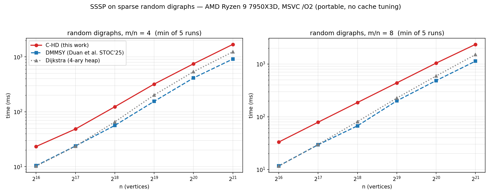
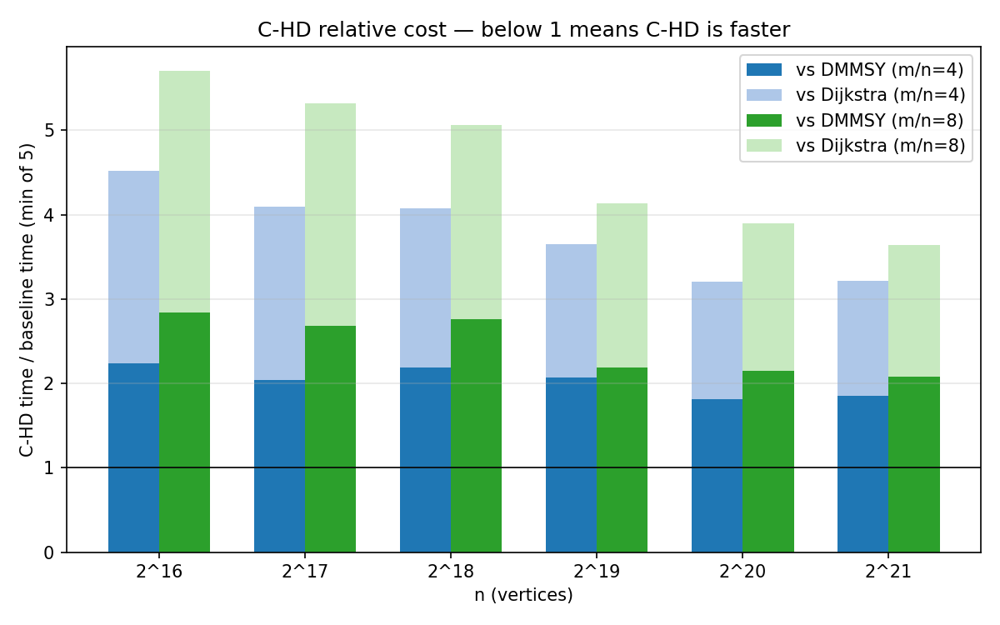

# C-HD — Concise Heuristic Decomposition SSSP in high-performance C

A C (MSVC, C17) implementation of the **C-HD** single-source shortest-path
(SSSP) algorithm for directed graphs with non-negative real weights, with an
honest comparison against **DMMSY** (Duan, Mao, Mao, Shu, Yin — *Breaking the
Sorting Barrier for Directed Single-Source Shortest Paths*, STOC 2025;
reference implementation: [DMMSY-SSSP](https://github.com/danalec/DMMSY-SSSP))
and against Dijkstra with a 4-ary heap.

Algorithm reference: the C-HD paper draft (directory `ref-chd-proof/`, Lean
specification `Frontier.CHD.Final`), announced on the
[vals.ai](https://www.vals.ai/blogs/faster-shortest-path-algorithm) blog.

```
T(n,m) = O(n + m + m·lg(2 + m/(n+1)) + m^{1/3}·(n·lg(n+2))^{2/3})
```
certified for `m ≤ n·⌊⌊log2 n⌋^{3/4}⌋`; outside that window the dispatcher
(SS.1/Sec.6) falls back to verified Bellman-Ford.

## How to build and run (Windows, MSVC x64)

The DMMSY comparison baseline is compiled **verbatim** from the `ref-dmmsy`
git submodule, so clone with submodules (or run `git submodule update --init`):

```bat
git clone --recursive https://github.com/danalec/C-HD.git

build.bat Debug tests      :: correctness suite (with debug asserts)
build.bat Release tests    :: optimized suite
build.bat Release bench    :: C-HD vs DMMSY vs Dijkstra benchmark
build.bat Release all      :: both

build\Release\test_chd.exe            :: 126 checks vs Dijkstra
build\Release\chd_bench.exe 21 5      :: up to n=2^21, 5 repetitions
set CHD_T=128 && build\Release\chd_bench.exe   :: try a fixed t (0 = adaptive)
```

Development tools:

```bat
build_asan.bat        :: suite under AddressSanitizer (detects heap corruption)
build_asan_bench.bat  :: benchmark driver under ASan
build_prof.bat        :: benchmark with the phase profiler (/DCHD_PROF)
python scripts\plot_bench.py   :: regenerate results/fig_*.png from the CSV
```

## What is what in the code (code ↔ paper map)

| Phase | Where | Description |
|---|---|---|
| P1–P2 | `chd_preprocess` | drop vertices with no in-edge + stable dedup by `(v, w)` |
| P3 | `chd_preprocess` | degree reduction via zero-weight chains (chunks of degree ≤ δ−1) |
| P4 | `slot_sort` | static per-range sort by `(w, head)`; scans use the resume pointer `ptr[]` |
| FH.1–26 | `fh_search`, `partition_tree` | pivot searches with *virtual settling* and wall beating |
| MP.1–10 | `find_pivots` | MakePivots: tree partitioning, groups, elected pivots |
| BM.1–31 | `bmssp` | main loop: Pull (BFPRT) → group expansion → child call → Merge → settle scans |
| BC.1–9 | `base_case` | bounded Dijkstra on an indexed 4-ary heap + leftover-heap-to-DS' conversion |
| DS' (Sec 3.4) | `dstr_*` | separator blocks, binary-search insertion, Pull with split, Merge by ordered splicing |
| SS.1 | `chd_sssp` | density-window dispatcher + Bellman-Ford fallback |
| P5 | `chd_run` | maps virtual labels back to original vertices |

## Deviations from the paper (all documented and tested)

1. **Lexicographic `(len, hops, eid)` labels** instead of the draft's formal
   tie-break; equivalence validated by the suite (zero-weight graphs, cycles,
   parallel edges).
2. **FindPivots flattened into a single search** per root with *virtual
   settling* (`ustamp` per invocation, re-marked at the end); the returned `W`
   is a superset of the paper's `W` (all runs, not just failures) — soundness
   argument: labels are final by Dijkstra extraction order.
3. **Adaptive `t`**: the paper fixes `t ≥ 16`; empirically the recursion
   degenerated into ~N/t tiny calls whose fixed cost dominates. We use
   `t = max(paper, ⌈2·cbrt(N)⌉)`, ~2× faster across the whole window.
   Exactness is independent of `t` (all 126 checks pass) and the certified
   invariant `lgN² ≤ t³·dd²` is only strengthened by a larger `t`.
4. **Base-case DS' built lazily** at BC.8 from the heap contents (equivalent:
   an unsettled key is always still keyed in the heap).
5. **Global stale semantics** for O(1) deletes (FIX-STALE), a `gdel` bitmap
   plus a `ghas_del` flag for the fast path when Lemma L never fires.

## Engineering optimizations (correctness untouched)

- **Workspace pools** for the base-case heap, `U` buffers, `DS'` structs and
  Pull/Merge scratch — removes ~10 allocations per recursive call (there used
  to be ~N/t calls per run).
- **Insertion sort** for rows of degree ≤ 32 (P2) and chunk ranges ≤ 32 (P4);
  **insertion-sort selection** for gathers ≤ 64 in Pull (BFPRT only above).
- **Indexed 4-ary heap** in the base case (fewer levels than binary).
- **Bulk `calloc`/memset** in workspace setup instead of a per-vertex
  initialization loop.
- Redundant checks removed from the hottest scans (`ok ⇒ ustamp==0`).
- **Scan-specialized relax**: each scan loop already builds `cand` and proves
  `cand < B` in its window test; the relax inherits `cand` (no rebuild) and
  uses a **single `lbl_cmp`** against `d[v]` for both admission and the
  strict-decrease test. Length-only pre-break (exact; ties fall through to
  the full comparison) and the `ustamp` check before assembling the label.
- **Bit-pattern `lbl_cmp`**: `len` is always a non-negative double (incl.
  +inf; never −0.0/NaN by construction), so its int64 bit pattern is
  order-isomorphic to its value and `(hops, eid)` packs into one u64 — two
  integer compares instead of the six-branch chain (clock-neutral: the chain
  already short-circuited on `len`; kept as strictly less work with no
  dependency on FP flags).
- **Division-free P3**: `dmax` rounded to a power of two and the per-vertex
  chunk count computed once (previously 4 integer divisions per vertex); the
  duplicate `cur_chunk` array (identical to `off`) was removed.
- **P2 buffers sized by max row degree** (previously 2 × m × 16 B of commit —
  a 512 MB peak at n=2²¹, m/n=8 — now a few KB; the oversized commit was
  never touched, so this is memory hygiene, not speed). The `Dew` `o` field
  is gone: the sorts are stable, which already realizes the dedup
  "first min-weight edge" rule without an explicit index.
- **Exact no-op loop skips in BMSSP**: BM.15 is skipped when `D` holds no
  live entries (a `live_total` counter maintained by insert/delete/pull/
  merge) and BM.16-18 when the call registered no groups — both guaranteed
  no-ops in the collapsed regime, where they save two O(N) passes.
- **`memcpy`/`memset` setup** (`ptr` mirrors `gSt`) and the base-case heap
  presized to N+1 at workspace setup.

Result: **~2.2× faster** than the direct paper implementation on the same
inputs (e.g. n=2¹⁸, m/n=8: 400 ms → 180 ms). The items above this section
added after that measurement were verified by interleaved A/B (3 runs, min
per cell) to be **clock-neutral** (±3%, within the noise of the DMMSY/
Dijkstra controls): the remaining time is dominated by the 16-byte-label
Dijkstra (59%) and the memory-bound preprocessing (34%), where the only big
levers would be data layout / cache affinity — excluded by methodology.

## Benchmark methodology (honest, no cache tuning)

- One seeded random graph per `(n, density)` cell, **shared** by all three
  algorithms; weights uniform in (0, 100].
- The first run of each algorithm in each cell is **verified against
  reference Dijkstra** (exact distances; the suite's 126 checks cover small
  graphs, zero weights, cycles and parallel edges).
- 5 timed repetitions, **interleaved round-robin** (C-HD, DMMSY, Dijkstra)
  per cell; we report min and median. `reps < 2` is raised to 2 (min/median
  need at least one timed repetition besides the verification pass; with
  `reps=1` the old driver crashed) and `max_exp` is clamped to 22 (MAXN
  buffer capacity).
- Portable `/O2 /Ob3`, **no `/arch:`ISA** — no processor-specific, L2/L3 or
  *cache-aware tuning* in any of the implementations. DMMSY is the **upstream
  code compiled unmodified** from the `ref-dmmsy` submodule
  (github.com/danalec/DMMSY-SSSP, pinned); `include/dmmsy_port.h` is
  force-included into its translation units only to provide MSVC shims
  (`__thread`, `__builtin_inf`) and to rename the four symbols this project
  also defines.

## Results (AMD Ryzen 9 7950X3D, min of 5 runs, in ms)

| n | m/n | C-HD | DMMSY | Dijkstra | C-HD/DMMSY |
|---|---|---|---|---|---|
| 65 536 | 4 | 23.3 | 10.4 | 10.2 | 2.24× |
| 65 536 | 8 | 33.2 | 11.7 | 11.6 | 2.84× |
| 131 072 | 4 | 48.5 | 23.8 | 23.5 | 2.04× |
| 131 072 | 8 | 78.9 | 29.5 | 29.9 | 2.68× |
| 262 144 | 4 | 123 | 56.3 | 65.4 | 2.19× |
| 262 144 | 8 | 186 | 67.4 | 80.9 | 2.76× |
| 524 288 | 4 | 320 | 155 | 202 | 2.07× |
| 524 288 | 8 | 439 | 200 | 226 | 2.19× |
| 1 048 576 | 4 | 749 | 413 | 538 | 1.81× |
| 1 048 576 | 8 | 1041 | 485 | 594 | 2.14× |
| 2 097 152 | 4 | 1692 | 914 | 1237 | 1.85× |
| 2 097 152 | 8 | 2358 | 1133 | 1510 | 2.08× |




Full CSV: `results/bench_results_final.csv` (generated by `chd_bench.exe`).

## An honest reading of the results

- Inside the dispatcher window, with the parameters that make C-HD work
  well, the recursion collapses to very few calls — the effective cost is
  essentially **a Dijkstra with 16-byte labels + P1–P4 preprocessing**. That
  explains the stable ~1.8–2.9× deficit to DMMSY and ~1.4–2.8× to Dijkstra.
- Phase profile (n=2¹⁸, m/n=8, one call): **base case 59%**,
  **preprocessing 34%** (P2 28 of 64 ms: per-row sort+dedup; P4 18 ms:
  per-chunk insertion sorts), BMSSP shell 5%, setup/teardown/mapback ~2%.
  Both dominant blocks sit at the instruction/memory floor of the portable
  build: the lexicographic comparisons already resolve on the first double,
  and the rest is 16-byte label traffic in the heap and scans — exactly what
  *cache tuning* (excluded by methodology) would address.
- DMMSY remains the fastest across the entire measured window; C-HD trails
  **even plain Dijkstra** across the whole measured range — the C-HD/
  Dijkstra ratio falls with n (2.3× at 2¹⁶ → 1.4× at 2²¹ for m/n=4,
  consistent with the theory's (lg n)^{2/3} vs lg n factor), but no
  crossover is observed up to 2²¹ and the decelerating trend (1.39 → 1.37
  over the last doubling) does not promise one at practical sizes. Practical
  constants (16 bytes/label, DS', preprocessing) dominate in this size
  range.
- C-HD's theoretical gain shows up at scales/densities where the recursive
  decomposition actually fragments the work; here the `t` that minimizes
  empirical cost flattens the recursion, which is useful information in
  itself.

## Layout

```
include/chd.h        public API (graph, dispatcher, test hooks)
include/dmmsy_port.h MSVC/symbol-isolation shim for the DMMSY submodule sources
src/common.c         seeded graph generation, timing, CPU
src/dijkstra.c       O(m + n log n) reference (4-ary heap)
src/bellman_ford.c   verified fallback outside the window
src/chd.c            the full algorithm (~1900 lines, commented per section)
src/benchmark.c      honest-comparison driver
ref-dmmsy/           DMMSY-SSSP upstream, compiled verbatim (git submodule)
tests/test_chd.c     suite: 126 checks vs Dijkstra + clean ASan
results/             final CSV + figures
ref-chd-proof/       paper draft and Lean spec (git submodule of the public proof repo)
```

## License

This project is dual-licensed under the **MIT License** and **Apache License 2.0**. See the `LICENSE-MIT` and `LICENSE-APACHE` files for details. The benchmark links the upstream DMMSY-SSSP sources (git submodule `ref-dmmsy/`) unmodified, under their own dual MIT/Apache-2.0 license.

